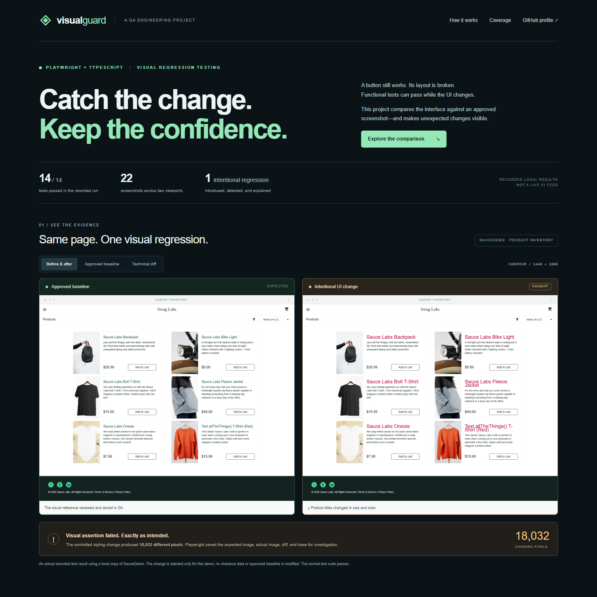

# playwrightCapabilities_VisualRegression
**Visual Guard — a visual testing portfolio**
### Catch the change. Keep the confidence.

A Playwright + TypeScript visual regression testing portfolio built around SauceDemo. It shows how a UI can remain functional while its appearance changes—and how automated screenshot comparisons catch that change.



**14 passing test cases · 22 approved screenshots · 2 viewport sizes · 1 demonstrated regression**

These are verified local results, not a live CI status badge.

## Start here

- **Explore the demo:** open `docs/index.html` or run `npm run demo:serve`. Switch between before/after, the clean baseline, and a clearly labeled technical diff.
- **Inspect the implementation:** [visual scenarios](tests/visual.spec.ts), [configuration](playwright.config.ts), and [GitHub Actions](.github/workflows/visual.yml).
- **Run it yourself:** follow the commands below or read the [technical guide](docs/GUIDE.md).

## What this demonstrates

The framework compares a stable UI with a reviewed reference. A controlled change makes product titles larger and red. The visual assertion fails, saves evidence, and leaves the approved baseline unchanged.

| Engineering decision | Why it matters |
| --- | --- |
| Pinned local SauceDemo source | Avoids unplanned public demo changes |
| Fresh browser context per test | Isolates login and cart state |
| Page, component, and journey checkpoints | Covers more than a homepage |
| Explicit page-state assertions | Confirms the intended screen before capture |
| Wait for images and fonts; disable animation | Reduces screenshot noise |
| Baselines grouped by OS and viewport | Makes rendering differences explicit |
| HTML report, pixel diff, and trace | Provides evidence for investigation |
| GitHub Actions with report artifacts | Automates checks on pull requests |

The intentional regression produced **18,032 changed pixels**. The raw diff is a debugging artifact; the public demo leads with readable before-and-after screenshots.

## Run the framework

Use Node.js 22.12 or newer. From the project folder:

```sh
npm ci
npx playwright install chromium
npm test
npm run report
```

Demonstrate a failure:

```sh
npm run demo:regression
npm run report
```

That command is **supposed to fail**: it injects a styling change to prove the detector works. Run `npm test` afterward to restore a passing report.

## Coverage

| Area | Visual checkpoints |
| --- | --- |
| Login | Default and validation |
| Products | Inventory, card, details |
| Cart | Empty and filled |
| Checkout | Information, validation, summary, confirmation |

Seven scenarios run at 1440×1000 and 390×844, producing 14 cases and 22 snapshots. The narrow project uses a desktop browser with a narrow viewport; it does not emulate a mobile device.

## Share the portfolio

The `docs/` folder is a buildless static demo with no login, backend, external fonts, or paid services. Visitors explore recorded results without installing Playwright. It does not run tests in their browser.

For **GitHub Pages**, push this project to a repository, then choose **Settings → Pages → Deploy from a branch → main → /docs**. Add the supplied public URL to the repository's About section and your LinkedIn post.

For **LinkedIn**, attach [the overview image](docs/assets/portfolio-preview.png) and use [LINKEDIN.md](LINKEDIN.md). Share both the demo and repository URLs. Hosting and public CI execution have not been verified yet.

## Technical notes

Windows baselines are included. Other OSes require reviewed baselines; hosted CI can differ in fonts or rendering. The workflow targets Windows. Review intentional changes before updating baselines. Visual comparisons complement functional checks; they do not judge whether a design is good.

SauceDemo is provided by Sauce Labs under its [MIT license](demo-app/LICENSE), pinned at `ad62bb2d7950bc5747af46a75aa1fb1bd6b8622a`. This is an independent portfolio project. See the [technical guide](docs/GUIDE.md) for setup and maintenance details.

