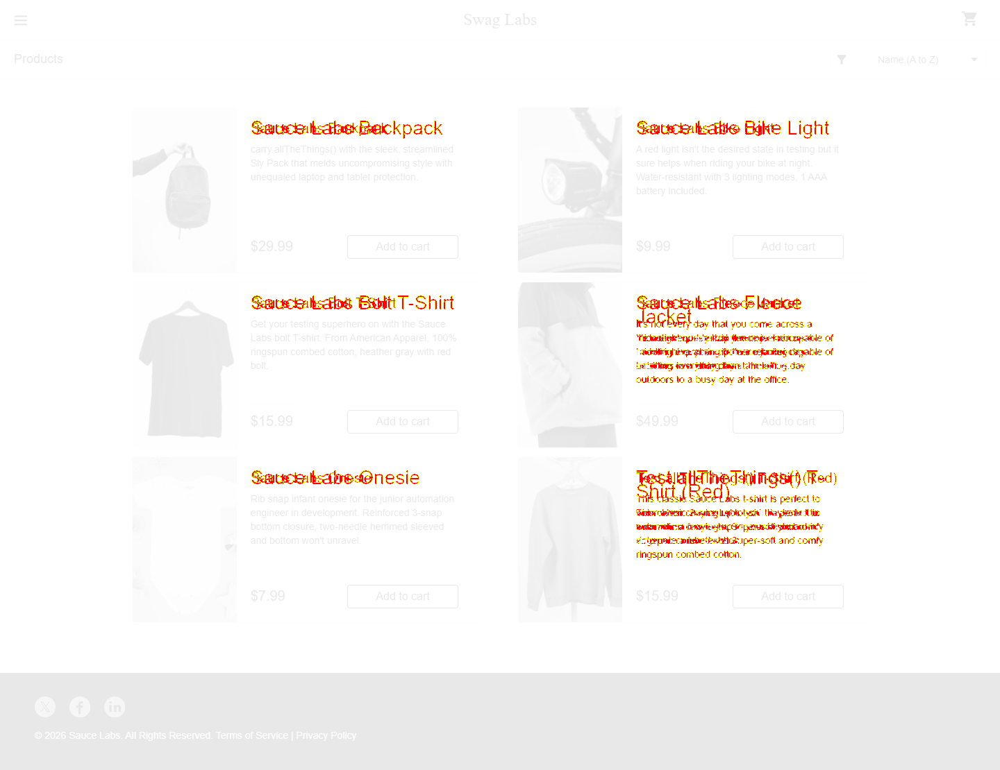

# SauceDemo visual comparisons with Playwright

A runnable TypeScript portfolio project with a pinned, local SauceDemo app, 11 visual checkpoints at two viewport sizes, screenshot baselines, HTML reports, traces, and GitHub Actions.

## Run in VS Code

Open this folder in VS Code. Use Node.js 22.12 or newer, then run these commands in its terminal:

```sh
npm ci
npx playwright install chromium
npm test
npm run report
```

Playwright starts the local app automatically. To explore it manually, run `npm run app` and open http://127.0.0.1:3000. Demo credentials: `standard_user` / `secret_sauce`.

`npm run test:ui` opens Playwright UI mode. `npm run typecheck` checks the framework's TypeScript.

## Coverage

Seven independent tests produce 11 screenshots per viewport: login, login validation, inventory, product card, product details, empty cart, filled cart, checkout information, checkout validation, order summary, and confirmation. The checkout test follows one complete journey. Each test receives a fresh browser context.

Projects use Chromium at 1440×1000 and 390×844. The narrow project tests a narrow desktop viewport; it does not emulate a physical mobile device. Fonts and images are awaited before capture. Local tests block external requests, including analytics and remote fonts; bundled fonts and system fallbacks are used. Animation is disabled. Pixel differences above the configured per-pixel color threshold fail the assertion; no changed pixels are allowed by default.

## Review baselines

Windows baselines are included under `tests/baselines/win32`. Baseline paths include the OS and project because rendering can vary across platforms. The workflow uses Windows as well; hosted runner font or OS differences can still require an initial reviewed baseline update. Other operating systems require their own reviewed baseline set.

After an intentional UI change:

```sh
npm run test:update
npm test
npm run report
```

Review the PNG changes before committing them. Never automatically approve failed screenshots in CI. Missing baselines fail the normal run. GitHub Actions uploads its report and failure artifacts on every run; its first hosted run has not been verified locally.

## Demonstrate a real visual failure

```sh
npm run demo:regression
npm run report
```

This injects a larger, red product title into the inventory page. It deliberately exits unsuccessfully. The report shows expected, actual, and difference images. No app source or baseline is modified. Run `npm test` afterward to restore the normal passing report.

Verified locally: all 14 cases passed against 22 saved screenshots. The intentional regression failed with 18,032 changed pixels. See the [interactive walkthrough](index.html) for a labeled before-and-after comparison.

<details>
<summary>Technical diagnostic image: how to read a pixel diff</summary>

This is a diagnostic map, not the website. Unchanged areas are faded; highlighted pixels mark visual differences. Overlapping text shows original and changed positions.



</details>

## Optional hosted target

PowerShell:

```powershell
$env:BASE_URL = 'https://www.saucedemo.com'
npm test
Remove-Item Env:BASE_URL
```

The local server is skipped for a supplied URL. Hosted screenshots use a separate `tests/baselines/hosted` baseline set. Generate and review those with `npm run test:update` while `BASE_URL` is set. The hosted site was not tested as part of this deliverable.

## App source and license

`demo-app` contains the Sauce Labs sample app at commit `ad62bb2d7950bc5747af46a75aa1fb1bd6b8622a` from https://github.com/saucelabs/sample-app-web, under its included MIT license. Upstream source and assets are preserved. Root `package.json` and `vite.config.ts` supply a smaller runtime harness compatible with Node 22 and pin React 18 to support the menu dependency's default props; do not install the upstream app's Storybook/test toolchain. The upstream package files describe its original setup. The app's copyright year is dynamic; annual changes require a reviewed baseline update.

## Publish to GitHub

Create an empty repository, then from this folder:

```sh
git init
git add .
git commit -m "Add SauceDemo Playwright visual testing demo"
git branch -M main
git remote add origin https://github.com/jalindret/playwrightCapabilities_VisualRegression.git
git push -u origin main
```

Dependencies and generated reports are ignored; screenshot baselines and the lockfile are committed. No paid visual testing service or Sauce Labs account is required for this framework.
